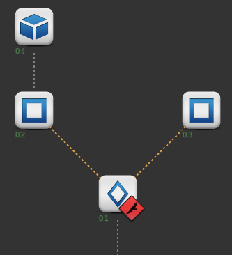
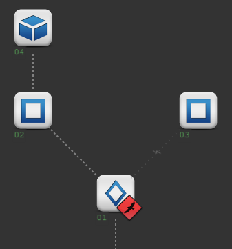

# Network switch
This layer makes the hacker choose which way to go: one of the routes leaving the node, for example research or archives.



Until a choice is made, these routes are shown in amber on the map and cannot be used. Scanning past them is possible,
so hackers can see what lies behind each route before choosing.

```
⇋ move 02
[blocked] route to 02 held in standby by a network switch.
```

## Hacking
Hacking the network switch shows its routing table. Add the name of a route (or the network id of the node it leads to) to choose it.

```
⇋ hack 1
Routing table:
  hack 1 research  → 02
  hack 1 archives  → 03
[warning] switch firmware locks after first route commit. Uncommitted routes will be dropped.

⇋ hack 1 research
[Topology change] switch 01 locked to research. Dropped routes: 03
```



The choice is made for everyone in the site. The routes that were not chosen are dropped: they are shown greyed out
with a ⌁ on the map, and nobody can move through them anymore.

## Unlocking network switches

A site reset does not undo the choice. If a switch is linked to a core, hacking that core unlocks the
network switch, allowing hackers to choose another route.

```
⇋ hack 1
Switch locked. Route fixed to research → 02.
Lock managed by core in node 09
```

## Details

Routes managed by a network switch can be in 3 states:

- pending
- open
- dropped

### Pending route

Scans work through pending routes. But hackers cannot move through them, even with scripts that jump to a node.

Hackers can be behind a pending route if they moved there and then the network switch was unlocked. Other hackers can
join them with the jump skill or a script that jumps them to another hacker.

### Open route

This is a normal connection between nodes.

### Dropped route

Nothing goes past a dropped route. When a route gets dropped, hackers that are behind it are disconnected.
